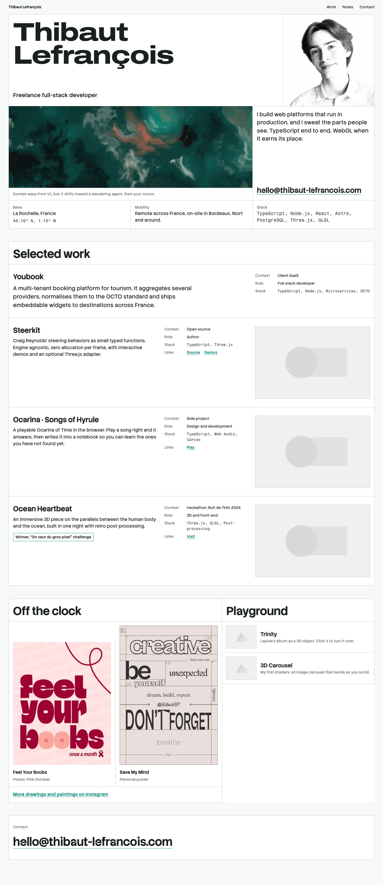
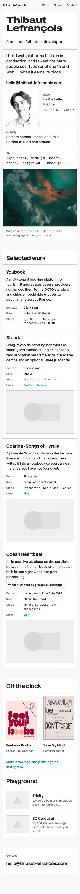

# Art direction: Specification

Decision record for the V2 art direction (validation point V0, 2026-10-17). The prototypes lived on the throwaway `v2-da` branch; this file and the two captures beside it are what remains of them.

## The decision

**Direction B, "Specification": the site as a specification sheet.** The grid is the layout itself: sheets of white cells bounded by hairlines on a sage ground. Wide lettering for the name, a sober grotesk for everything else, mono only where the content is data. The language comes from Thibaut's own poster *Save My Mind* (visible grid, hairlines, mixed scales), which is why it reads as his rather than as a template.

The frame stays quiet and precise; colour comes from the works: the hero shader, the project visuals, the posters.

## Type

| Role | Face | Setting | Used for |
|---|---|---|---|
| Wordmark | Archivo | weight 800, width 125% | The name in the hero, nothing else |
| Titles | Stack Sans Headline | weight 700 | Section titles, project titles, the large footer email |
| Text | Stack Sans Text | weight 400 to 500 | Body, captions, labels, navigation |
| Email | Stack Sans Notch | weight 700 | The email address only, at display size |
| Data | Fragment Mono | 400 | Stack lists, coordinates, measurements. Never decoration |

All five are SIL Open Font License. Stack Sans is Stack Overflow's brand typeface; the association was weighed and accepted.

**Budget.** Measured after instancing to the axes used and subsetting to Latin: Archivo 10.5 KB, Stack Sans Headline 14.8 KB, Stack Sans Text 24.5 KB, Stack Sans Notch 14.9 KB, Fragment Mono 21.6 KB, about 86 KB in all. Archivo and Notch each set a single known string, so Phase 1 subsets them to the glyphs of that string (a few KB each). Only the wordmark is preloaded.

**Rules.** Archivo never goes below the hero name. Notch never goes below display size. No serif anywhere.

## Colour

Radix Colors 3.0.0, sage neutral with teal accent (Radix's natural pairing). Light theme only; the roles below are the semantic tokens, so a dark theme stays a one-file addition.

| Role | Value | Contrast |
|---|---|---|
| Ground | sage-2 | |
| Surface (cells) | white | |
| Text | sage-12 | 16.4:1 on white |
| Secondary text, labels | sage-11 | 5.95:1 on white |
| Hairlines | sage-7 | decorative, 1px |
| Links | teal-11 | 4.56:1 on white; never on a tinted ground |
| Underlines, hovered frames | teal-9 | 3:1 or more against white (non-text) |
| Focus ring | teal-11, 2px, 2px offset | 4.47:1 against sage-1 |
| Selection | teal-4 background, sage-12 text | |

Three Radix roles fail WCAG 2.2 AA and are replaced: teal-11 as body text on sage (4.47:1), white text on teal-9 (3.07:1) and teal-7 as a focus ring (1.79:1). Hover states never tint a cell, because teal-11 links fail on any tinted ground (4.34:1 on teal-2).

## Layout and spacing

- Twelve columns on desktop, cells spanning whole columns; one column of cells under 60rem.
- Every section is a sheet: top and left border on the sheet, right and bottom border on each cell, so hairlines never double.
- Strict 4px-based spacing scale: 0.25, 0.5, 0.75, 1, 1.5, 2, 3, 4 and 6rem. Page gutter fluid from 0.75rem to 2rem.
- Fluid type scale from 0.8125rem to 6rem through `clamp()`.

## Images and video

- Project visuals at 16:10 in their own cell, 1px hairline frame; the frame turns teal-9 on hover.
- The portrait in black and white, square, filling its cell.
- Posters at their natural ratio, in cells.
- Playground loops: poster frame by default, play on hover or focus, never under reduced motion.

## Motion

Dry and short: 140ms with `cubic-bezier(0.2, 0, 0, 1)`. On hover a project title underlines and its image frame turns teal. The shader is the only continuous motion on the page.

## Shader

The domain warp from the V1 `gallery-redesign` branch, ported to WebGL2: ink, teal-12, teal-9, coral and ivory folding into each other, with a vignette and grain. From the flow-field study it keeps the wandering agent: the warp is always pulled toward a slow autonomous point, and the cursor takes over when it is on the cell. Ink (#091213), coral (#f2785c) and ivory (#f5ede0) are the shader's own colours, outside the Radix tokens: the shader is a work, and works carry their own colour.

Lifecycle rules: starts after load on idle, pauses off-screen and in hidden tabs, pixel ratio capped at 1.5 and rendered at 75% resolution, a static frame under reduced motion or without WebGL2, and a visible pause button (WCAG 2.2.2).

## Rejected directions

- **A, Monograph** (Besley serif, title page and frontispiece): serif titles do not fit the positioning.
- **C, Gallery** (condensed vinyl lettering, colour plates): the loudest frame, competes with the works.
- **D, Studio** (V1 gallery-redesign layout, Cabinet Grotesk and Satoshi): its shader was kept; the layout lost to B.
- **B with Cabinet Grotesk and Satoshi**: over the font budget, ITF licence, and softer than the sheet needs.
- **Other cell shaders** (flow field, light warp, contours, halftone): the V1 warp won; the flow field gave the wandering agent.

## Open for Phase 1

- Header: B keeps a minimal header (name, Work, Notes, Contact). Keep it, or drop it as in the V1 layout.

